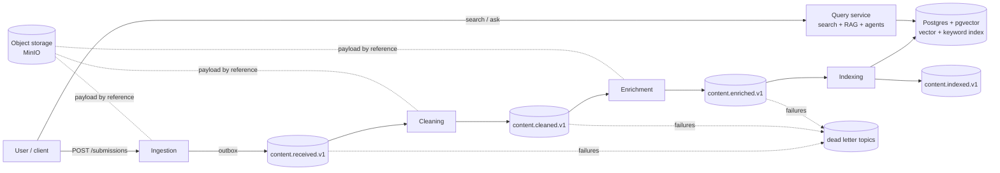

# Prism Roadmap

The end-to-end plan for Prism, broken into phases and small milestones. Each milestone is
one reviewable slice: it builds one thing, teaches one concept, and has a clear "done when"
check. Plan first, approve, then implement, one milestone at a time.

---

## 1. What we are building

Prism takes in content (articles, documents, notes), runs it through a chain of
independent services that clean, enrich, classify, summarize, and index it, and then lets
users **search** it and **ask questions about it** through RAG (retrieval-augmented
generation) and AI agents.



### Item lifecycle

```
RECEIVED → CLEANED → ENRICHED → INDEXED        (any stage can → FAILED, with a reason)
```

### Where RAG fits

RAG is not one service. It is a capability that spans the back half of the pipeline:

| RAG step | Where it happens | Phase |
|---|---|---|
| **Chunk** documents into retrievable pieces | Enrichment | 4 |
| **Embed** chunks into vectors | Indexing | 6 |
| **Store** vectors + keyword index | Indexing (pgvector) | 6 |
| **Retrieve** the most relevant chunks for a question | Query | 7 |
| **Generate** a grounded answer with citations | Query | 7 |
| **Evaluate** retrieval and answer quality | `eval/` | 5, 7 |
| **Agents** that use retrieval as a tool | Query | 8 |

The pipeline is the *write path* that prepares knowledge. RAG is the *read path* that uses it.

---

## 2. Rules that hold in every phase

These come from CLAUDE.md. Every milestone is reviewed against them.

1. **Kafka only between services.** No service calls another over HTTP.
2. **Versioned envelope** for every message (`shared/schemas/`). Changes add a new version.
3. **At-least-once + idempotency.** Every write is keyed on item id / chunk id, so replaying
   an event never duplicates an effect.
4. **Large payloads by reference.** Messages carry an object-storage key, not raw bytes.
5. **Dead letter topics** with the failure reason. Nothing is silently dropped.
6. **Each service stands alone:** own pom, Dockerfile, README, tests.
7. **No future-phase technology early.**

Each significant design choice gets a short ADR (architecture decision record) in
`docs/decisions/`: context, options, choice, consequences. This is what lets you defend
every decision in an interview.

---

## 3. Phases at a glance

| Phase | Theme | Outcome |
|---|---|---|
| 0 | Foundations | Scaffold committed, conventions set |
| 1 | Ingestion MVP | Submit content over HTTP, stored in Postgres, runs in Docker |
| 2 | Kafka backbone | Ingestion reliably publishes events (outbox, envelope, object storage) |
| 3 | Cleaning service | First consumer: idempotency, retries, DLT, status tracking |
| 4 | Enrichment | LLM classification, summary, entities, and chunking for RAG |
| 5 | Enrichment eval | Measure enrichment quality with a dataset and metrics |
| 6 | Indexing | Embeddings + pgvector + keyword index; content becomes searchable |
| 7 | Query + RAG | Hybrid search, grounded Q&A with citations, RAG evaluation |
| 8 | AI agents | Tool-using agents over the corpus, with guardrails |
| 9 | Observability | Traces across Kafka, metrics, dashboards |
| 10 | Kubernetes | Helm charts, autoscaling on consumer lag |
| 11 | Hardening & polish | Auth, load/chaos tests, docs, demo |

---

## Phase 0: Foundations ✅ (mostly done)

**Why:** a consistent skeleton makes every later service a copy of a known-good pattern.

| # | Milestone | Done when |
|---|---|---|
| 0.1 | Ingestion scaffold: Spring Boot 3, Java 21, Flyway, actuator, Testcontainers test | ✅ App boots and connects to Postgres |
| 0.2 | Multi-stage Dockerfile + Compose with Postgres health check | ✅ `docker compose up` shows healthy |
| 0.3 | First commit of the scaffold on a branch | Clean `git status`, `.env` not tracked |
| 0.4 | `docs/decisions/` folder with ADR template; ADR-001 "Kafka-only communication" | Template exists, first ADR written |

**Concepts:** multi-stage Docker builds, Flyway-owned schemas, Testcontainers.

---

## Phase 1: Ingestion MVP (HTTP + Postgres, no Kafka)

**Why:** the entry point has to be correct before anything flows downstream. This phase
teaches clean layering (`api` → `domain` → `persistence`) on the simplest possible service.

| # | Milestone | Done when |
|---|---|---|
| 1.1 | **Schema:** Flyway `V1__create_submissions.sql`: `id (uuid)`, `source`, `title`, `content_type`, `content`, `status`, `created_at`, `updated_at` | Migration runs in the test container |
| 1.2 | **Domain:** `Submission` model + `SubmissionStatus` enum (`RECEIVED`), with no Spring/JPA imports | Unit tests for creation rules |
| 1.3 | **Persistence:** JPA entity + repository, mapping to and from the domain model | Repository integration test saves and loads |
| 1.4 | **API:** `POST /submissions` with Bean Validation, returns `201` + id + `Location` header | Valid → 201, invalid → 400 |
| 1.5 | **Errors:** global handler returning RFC 7807 `ProblemDetail` | Consistent error JSON for 400 / 404 / 500 |
| 1.6 | **Read endpoint:** `GET /submissions/{id}` returns status | 200 for existing, 404 otherwise |
| 1.7 | **Idempotent submit:** optional `Idempotency-Key` header with a unique constraint, so a retry returns the original id | Same key twice → one row, same id |
| 1.8 | **Size limit:** reject payloads over N KB (object storage comes in Phase 2) | 413 for oversized |
| 1.9 | **CI:** GitHub Actions runs `mvn verify` for the service | Green check on PR |

**Concepts:** layered architecture, validation, ProblemDetail, idempotency keys, unique
constraints as a correctness tool.

**Phase exit:** `curl -X POST localhost:8080/submissions …` returns an id, and a `RECEIVED` row exists.

---

## Phase 2: Kafka backbone

**Why:** this is where Prism becomes distributed. The key problem is the *dual write*:
saving to Postgres **and** publishing to Kafka can't be atomic, so one can succeed while the
other fails. The **transactional outbox** pattern solves this.

| # | Milestone | Done when |
|---|---|---|
| 2.1 | **Kafka in Compose** (single broker, KRaft mode, no Zookeeper) + Kafka UI for inspection | Broker healthy, topics visible |
| 2.2 | **Envelope v1** in `shared/schemas/`: `eventId`, `eventType`, `schemaVersion`, `itemId`, `occurredAt`, `traceId`, `payload`. ADR: JSON Schema vs Avro vs Protobuf | Schema file + shared Java record, validated in tests |
| 2.3 | **Topic conventions:** `prism.content.received.v1`, partition by `itemId`, matching `.dlt` topics. ADR | Topics created on startup |
| 2.4 | **Outbox table** (`V2__outbox.sql`): submission + outbox row written in **one** DB transaction | Both rows or neither |
| 2.5 | **Outbox relay:** polls unsent rows, publishes, marks sent (ADR: polling vs Debezium CDC) | Event appears on topic; killing the app mid-way loses nothing |
| 2.6 | **Object storage:** MinIO in Compose; content over a threshold goes to MinIO and the event carries `contentRef` | Large submit → object in MinIO, small event on Kafka |
| 2.7 | **Integration test** with Kafka + Postgres Testcontainers: submit → consume from topic | Test green |

**Concepts:** dual-write problem, transactional outbox, partitioning and ordering, KRaft,
claim-check pattern (payload by reference), schema evolution.

---

## Phase 3: Cleaning service (the first consumer)

**Why:** the first consumer establishes the template every later service copies:
consume → process idempotently → publish → handle failures.

| # | Milestone | Done when |
|---|---|---|
| 3.1 | Scaffold `services/cleaning` (`consumer`, `domain`, `persistence`, `messaging`, `config`) | Boots, joins consumer group |
| 3.2 | **Cleaning logic (domain):** strip HTML/boilerplate, normalize whitespace and unicode, detect language, compute a content hash | Unit tests on sample docs |
| 3.3 | **Idempotency:** `processed_events(event_id)` table + upserts keyed on `itemId`; ADR on the inbox pattern | Replaying the same event → no duplicate effects |
| 3.4 | **Publish** `prism.content.cleaned.v1` (cleaned text stored by reference) via the outbox | Event on topic |
| 3.5 | **Failure handling:** retry with backoff for transient errors, DLT for poison messages, reason in headers | Malformed event lands in `.dlt` with a reason |
| 3.6 | **Duplicate detection:** same content hash → mark as duplicate, skip downstream | Re-submitting identical text doesn't re-enrich |
| 3.7 | **Status tracking:** ingestion consumes stage events (`cleaned`, `failed`) to update item status | `GET /submissions/{id}` shows `CLEANED` |

**Concepts:** consumer groups, offset commits, at-least-once semantics, inbox/idempotent
consumer, retry vs DLT, poison messages.

---

## Phase 4: Enrichment (LLM metadata + chunking for RAG)

**Why:** this is where AI enters. LLM calls are slow, cost money, and can fail or return
malformed output, so the engineering is about **reliability and cost**, not just the
prompt. Chunking also happens here, because how documents are split decides how good RAG
retrieval can ever be.

| # | Milestone | Done when |
|---|---|---|
| 4.1 | Scaffold `services/enrichment`; Redis added to Compose | Boots, consumes `cleaned.v1` |
| 4.2 | **LLM client port** (domain interface) + adapter. ADR: provider choice, hosted API vs local model | Adapter swappable, mocked in tests |
| 4.3 | **Classification:** category + tags using structured (JSON) output, validated against a schema | Invalid LLM output → retry, then DLT |
| 4.4 | **Summary + entities** (people, orgs, topics) | Stored keyed on `itemId` |
| 4.5 | **Redis cache** keyed on `contentHash + promptVersion`, so reprocessing doesn't pay twice | Second run hits the cache (metric/log proves it) |
| 4.6 | **Rate limiting and cost guard:** token budget, concurrency limit, backoff on 429 | Load of 100 items stays under the limit |
| 4.7 | **Chunking:** ADR comparing fixed-size + overlap, recursive/structure-aware, and semantic chunking. Deterministic `chunkId = hash(itemId, index, text)` | Same doc → identical chunk ids every run |
| 4.8 | **Chunk metadata:** each chunk carries `itemId`, position, section heading, category | Visible in event payload |
| 4.9 | **Publish** `prism.content.enriched.v1` (chunks stored by reference) | Event on topic, status `ENRICHED` |

**Concepts:** ports and adapters, structured LLM output, prompt versioning, caching for
idempotency and cost, rate limiting, chunking trade-offs (chunk size vs context precision).

---

## Phase 5: Enrichment evaluation (`eval/`)

**Why:** "the LLM seems to work" is not engineering. Without measurement you can't tell
whether a prompt change made things better or worse. It also makes a strong portfolio story.

| # | Milestone | Done when |
|---|---|---|
| 5.1 | **Dataset:** 50–100 labeled documents (expected category, key entities) in `eval/datasets/` | Versioned dataset file |
| 5.2 | **Harness:** runs the enrichment domain logic offline against the dataset | One command produces a report |
| 5.3 | **Metrics:** classification accuracy/F1, entity precision/recall | Numbers in the report |
| 5.4 | **Summary quality:** LLM-as-judge rubric (faithfulness, coverage) | Scored per document |
| 5.5 | **Regression gate:** CI fails if metrics drop below a baseline | Prompt change that hurts quality fails CI |

**Concepts:** offline evaluation, golden datasets, LLM-as-judge and its limits, regression testing for AI.

---

## Phase 6: Indexing (embeddings + vector store)

**Why:** this makes content retrievable. Hybrid search (vectors **and** keywords) beats
either alone. Vectors catch meaning ("car" ≈ "automobile"), keywords catch exact terms
(error codes, names).

| # | Milestone | Done when |
|---|---|---|
| 6.1 | **Vector store ADR:** pgvector vs Qdrant (recommendation: pgvector, since it reuses Postgres and allows SQL filters + keyword search in one place) | ADR written |
| 6.2 | Scaffold `services/indexing`; Postgres image switched to one with pgvector | Extension enabled via Flyway |
| 6.3 | **Embedding port + adapter.** ADR: embedding model choice (dimensions, cost, hosted vs local) | Chunks → vectors, cached in Redis by chunk hash |
| 6.4 | **Chunk table:** `chunk_id (pk)`, `item_id`, `text`, `embedding vector(n)`, `tsvector`, metadata, `embedding_model` | Upsert on `chunk_id`; replay → no duplicates |
| 6.5 | **Indexes:** HNSW for vectors, GIN for full-text | `EXPLAIN` shows index use |
| 6.6 | **Publish** `prism.content.indexed.v1`; ingestion marks `INDEXED` | End-to-end: submit → `INDEXED` |
| 6.7 | **Re-index by replay:** a new embedding model version re-consumes from offset 0 into a new column/table | Backfill works without re-submitting content |

**Concepts:** embeddings, vector similarity (cosine), ANN indexes (HNSW), full-text search,
event replay as a superpower of Kafka, model versioning.

**Open design point:** the query service reads the index that indexing writes. We treat the
index as a shared read store owned by indexing (like a search cluster), which keeps the
"no HTTP between services" rule intact. ADR records this and the alternative (query builds
its own read model from `indexed.v1` events).

---

## Phase 7: Query service + RAG

**Why:** this is the payoff. Users ask questions in natural language and get answers
grounded in *their* content, with citations they can verify.

### 7a. Retrieval

| # | Milestone | Done when |
|---|---|---|
| 7.1 | Scaffold `services/query` (`api`, `domain`, `persistence`, `config`) | Boots, read-only DB access |
| 7.2 | **Semantic search:** `GET /search?q=` embeds the query, top-k by cosine | Relevant results for sample queries |
| 7.3 | **Keyword search** via `tsvector` | Exact-term queries work |
| 7.4 | **Hybrid search:** merge both with Reciprocal Rank Fusion (RRF) | Beats either alone on the eval set |
| 7.5 | **Metadata filters:** category, source, date range | Filtered results correct |
| 7.6 | **Reranking (optional):** cross-encoder or LLM rerank of top-N | Measured improvement or dropped |

### 7b. Generation

| # | Milestone | Done when |
|---|---|---|
| 7.7 | **`POST /ask`:** retrieve → build prompt with numbered context chunks → generate | Answer returned |
| 7.8 | **Citations:** answer references chunk ids, and the response includes the source snippets | Every claim maps to a source |
| 7.9 | **Grounding rules:** answer only from context, otherwise say "not found in your content" | Out-of-corpus question → refusal, not a hallucination |
| 7.10 | **Context management:** token budget, dedupe overlapping chunks, include parent-document title | Long docs don't overflow the prompt |
| 7.11 | **Streaming** answers over Server-Sent Events | Tokens stream in the client |
| 7.12 | **Conversation follow-ups:** rewrite the follow-up question into a standalone query before retrieval | "What about its pricing?" retrieves correctly |

### 7c. RAG evaluation

| # | Milestone | Done when |
|---|---|---|
| 7.13 | **Golden Q&A set:** questions + expected source chunks + reference answers in `eval/` | Dataset versioned |
| 7.14 | **Retrieval metrics:** recall@k, MRR, nDCG | Report compares vector / keyword / hybrid / rerank |
| 7.15 | **Answer metrics:** faithfulness (grounded in context?), answer relevance, citation accuracy | Scored report |
| 7.16 | **Experiments:** chunk size, overlap, k, embedding model; record results in an ADR | Choices backed by numbers |

**Concepts:** retrieval vs generation, hybrid search and RRF, reranking, prompt grounding,
citations, query rewriting, RAG evaluation (and why retrieval quality caps answer quality).

---

## Phase 8: AI agents

**Why:** RAG answers one question with one retrieval. Agents can **plan**: search several
times, filter, compare documents, and combine results. Content in Prism is user-submitted
and therefore untrusted, so safety is part of the design, not an add-on.

| # | Milestone | Done when |
|---|---|---|
| 8.1 | **Tools:** `search`, `get_item`, `list_by_category`, `summarize_items`, exposed to the LLM via tool calling | Agent picks the right tool for a task |
| 8.2 | **Agent loop** with max steps, timeouts, and a token/cost budget | Runaway loops are stopped |
| 8.3 | **Research agent:** multi-step questions ("compare what sources A and B say about X") | Multi-hop answer with citations |
| 8.4 | **Prompt-injection defense:** retrieved content is clearly delimited as data, tools are read-only, output is checked | Test doc with "ignore previous instructions" doesn't hijack the agent |
| 8.5 | **Agent trace log:** every step, tool call, and token count stored for debugging | Trace viewable per request |
| 8.6 | **Agent eval:** task success rate on a scenario set | Report in `eval/` |
| 8.7 | **(Optional) MCP server:** expose Prism search as an MCP tool for external assistants | Usable from an MCP client |

**Concepts:** tool calling, agent loops and stopping conditions, indirect prompt injection,
least-privilege tools, agent observability.

---

## Phase 9: Observability

**Why:** in a distributed pipeline, "where is my document stuck?" is the most common
question. Tracing follows one item across every service and topic.

| # | Milestone | Done when |
|---|---|---|
| 9.1 | **OpenTelemetry** in all services; trace context propagated in Kafka headers | One trace spans submit → indexed |
| 9.2 | Tempo or Jaeger in Compose | Traces visible in a UI |
| 9.3 | **Prometheus metrics:** per-stage latency, throughput, error rate, consumer lag, DLT count | Scraped and queryable |
| 9.4 | **AI metrics:** LLM latency, tokens, cost per item, cache hit rate, RAG retrieval latency | Visible per model / prompt version |
| 9.5 | **Grafana dashboards** (pipeline health, AI cost, RAG) committed as JSON | Dashboards load on startup |
| 9.6 | **Structured JSON logs** with `itemId` and `traceId` | Grep one id → whole journey |
| 9.7 | **Alerts:** lag growing, DLT non-empty, error spike | Alert fires in a test |

---

## Phase 10: Kubernetes + Helm

| # | Milestone | Done when |
|---|---|---|
| 10.1 | Local cluster (kind or k3d); ADR on running infra (Bitnami charts / Strimzi operator for Kafka) | Cluster runs Postgres, Kafka, Redis, MinIO |
| 10.2 | Helm chart per service (or one umbrella chart) with values per environment | `helm install` brings up Prism |
| 10.3 | Liveness/readiness probes, resource requests/limits | Pods restart cleanly |
| 10.4 | Secrets via Kubernetes Secrets (sealed-secrets or external-secrets later) | No secrets in Git |
| 10.5 | **Autoscaling on consumer lag** with KEDA | Burst of submissions → enrichment scales out |
| 10.6 | Rolling deploy with no message loss | Deploy during load, zero lost items |

---

## Phase 11: Hardening & portfolio polish

| # | Milestone | Done when |
|---|---|---|
| 11.1 | **Auth:** API keys or JWT on ingestion and query; per-tenant data isolation | Unauthenticated → 401; tenants can't see each other's content |
| 11.2 | **Rate limiting** on public endpoints | Abuse → 429 |
| 11.3 | **Load test** (k6 or Gatling): throughput and p95 per stage | Numbers in README |
| 11.4 | **Chaos test:** kill consumers or the broker mid-flow; prove no loss, no duplicates | Documented experiment |
| 11.5 | **Minimal UI:** submit, see status, search, ask, view citations | Demo-able in 2 minutes |
| 11.6 | **Docs:** architecture diagram, ADR index, "how a document flows" walkthrough | Repo explains itself |
| 11.7 | **Demo video / write-up** | Portfolio-ready |

---

## 4. Technology introduction timeline

| Technology | Introduced in |
|---|---|
| Spring Boot, Postgres, Flyway, Docker Compose, Testcontainers | 0–1 |
| GitHub Actions CI | 1 |
| Kafka (KRaft), MinIO object storage | 2 |
| LLM API, Redis | 4 |
| pgvector, embedding model | 6 |
| Reranker (optional) | 7 |
| OpenTelemetry, Prometheus, Grafana, Tempo/Jaeger | 9 |
| Kubernetes, Helm, KEDA | 10 |

---

## 5. Decisions still open

These are settled at their milestone with an ADR. Listed here so they aren't forgotten.

1. **Message format** (2.2): JSON Schema (simple, readable) vs Avro/Protobuf (compact, enforced evolution).
2. **Outbox relay** (2.5): polling publisher (simple) vs Debezium CDC (more infra, lower latency).
3. **LLM provider** (4.2): hosted API vs local model (Ollama); affects cost, quality, offline dev.
4. **Chunking strategy** (4.7): decided by eval results in 7.16.
5. **Embedding model** (6.3): hosted vs local, dimension size.
6. **Embedding location** (6.3): this plan embeds in **indexing** (enrichment only chunks), so
   vectors never travel through Kafka. The alternative is embedding in enrichment.
7. **Index ownership** (6): shared read store vs a query-owned read model.
